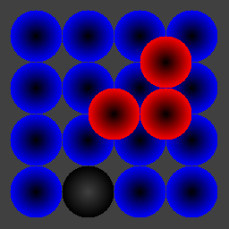
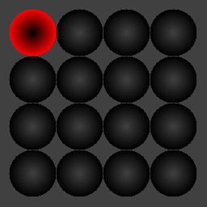
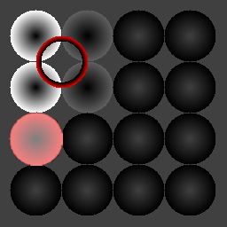
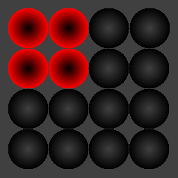
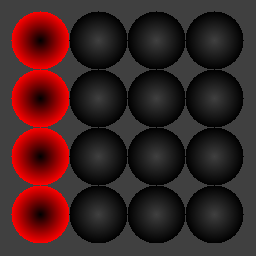
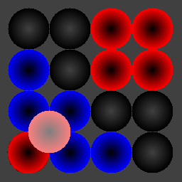
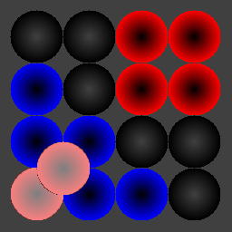

# Manual

Pylos is a two-player game.
Each player has 15 marbles.

## Goal

Be the one to place the top marble...

...or let the opponent run out of marbles.

## Gameplay

Every move, a player must either place a new marble
at a stable position...

...or move one of his/her own marbles to
a stable position on a higher level.
Click the left mouse button to select the desired marble.

## Removing marbles

If, on any layer, a 2x2 square of one's own marbles is formed...

...or, in advanced mode only, a straight line is formed
on one of the lowest two layers...

...a player may remove one of his/her marbles
from a free position (that is: no other marbles rest on it)...

...or two of his/her marbles.

Click the left mouse button to select one or two marbles.
Click the right mouse button to remove the selected marbles.
